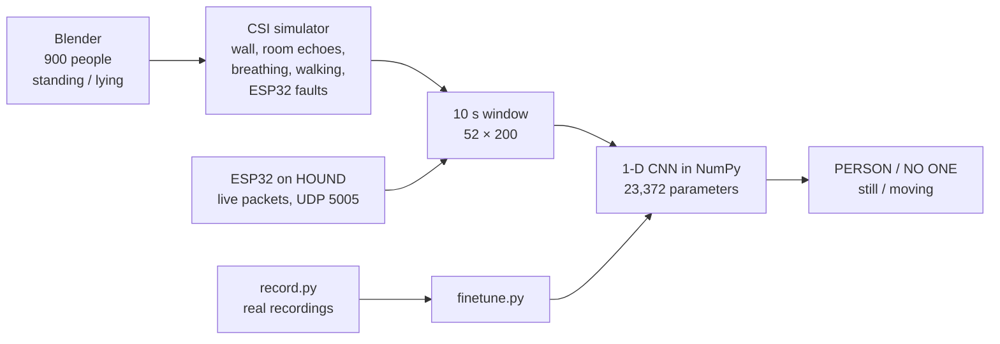
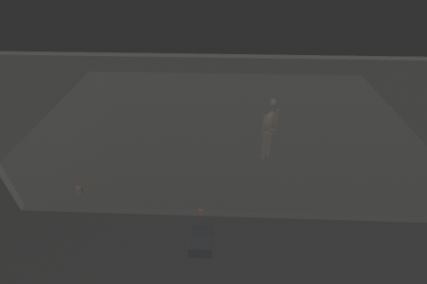
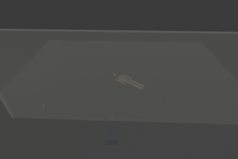

# HOUND

**A search-and-rescue rover that finds people it cannot see.** HOUND drives into a building on mecanum wheels, stops, and listens. A Wi-Fi link through the wall, three radars, a thermal camera and a webcam tell the rescue team whether someone is there. Its main sense is a neural network we built and trained from scratch. It reads how a person's body changes the Wi-Fi signal.

[](https://youtu.be/3qs2G0oVUek)

▶ **[Watch the film](https://youtu.be/3qs2G0oVUek)**

Named for the rescue dog: it stops, goes quiet, and listens.

---

## What HOUND does

| Sense | Hardware | What it answers |
|---|---|---|
| **Wi-Fi neural network** | Two ESP32-S3 boards: one sends 100 probes a second, one on HOUND measures each on 51 subcarriers | *Is someone behind the wall? Still or moving?* |
| **Tracking radar** | HLK-LD2450, 24 GHz | Where a moving person is (x, y, speed) |
| **Breathing radars** | Two HLK-LD2410C, 24 GHz | Range, and breathing-band periodicity through drywall |
| **Thermal** | MLX90640, 32 × 24 | Body heat |
| **Vision** | USB webcam | What HOUND is looking at, live |
| **Range** | Two VL53L1X ToF | Distance to walls and obstacles |

Everything is live on HOUND's web remote: drive, the Wi-Fi network's answer, the radar dots, the thermal image and the webcam.

---

## The Wi-Fi neural network (`ml/`)

When Wi-Fi crosses a room, a person's body reflects part of it. Their breathing and their steps change the signal by a fraction of a percent. HOUND's network reads those changes from the **channel state information (CSI)**: the strength of each of the 51 subcarriers, 100 times a second.



| Step | File | What we built |
|---|---|---|
| People | `ml/blender/make_people.py` | A Blender script that builds 900 people, 1.20–1.95 m tall, 70 % standing and 30 % lying down, at random spots behind the wall. It samples 24 points on each body's surface, with normals. The torso points breathe. |
| Signal | `ml/simulate_csi.py` | The channel on every subcarrier at channel 6's real frequencies: the direct path, 3–8 room echoes, and every body point as its own reflector through the wall. Breathing is 7–30 per minute, with a heartbeat. People walk at 0.3–1.0 m/s. A third of the empty rooms have an oscillating fan. Then the ESP32's own faults: gain jumps, drift, int8 noise, lost packets and timing jitter. |
| Window | `ml/csi_window.py` | One function for simulation, recording and live use. It removes the gain jumps and cuts 10 s into 20 bins a second, plus a motion row that keeps a walking person's fast flicker. |
| Network | `ml/net.py` | A 1-D CNN written from scratch in NumPy: three convolutions, pooling, a dense layer, two heads. We wrote every gradient by hand, and `tests/test_ml.py` checks each one against finite differences. NumPy runs on the Pi 4 without a 700 MB PyTorch install. |
| Training | `ml/train.py` | Split by person, never by window, so the test set holds only people the network has never seen. Class-balanced loss, time-reversal augmentation, early stopping. The PERSON threshold is set so at most 10 % of empty rooms raise an alarm. |
| Live | `ml/infer.py`, `pi/rover/web.py` | The remote's **Wi-Fi neural network** view: the 51 subcarriers as bars, then PERSON / NO ONE and still / moving. It pauses while HOUND drives and starts over when it stops. |
| Real data | `ml/record.py`, `ml/finetune.py` | Record labelled data on HOUND (`empty`, `still`, `moving`), fine-tune, and compare both models on recordings neither has seen. |

<p>


</p>

*Two of the 900 Blender people: one standing, one lying down. The wall runs across the top; the transmitter and HOUND's receiver are below it.*

### Results (simulation)

On 955 test windows from people and rooms the network never trained on (`ml/results/synthetic.md`):

| | |
|---|---|
| A **moving** person behind the wall is found | **86.9 %** |
| Still or moving, when someone is there | **91.5 %** |
| An empty room with a fan is called a person | 7.9 % |
| A **still** person, breathing only, is found | 21.4 % |
| One reading (10 s window + network) on a laptop | 1.1 ms |

What we learned:

- **The simulator has to be messy.** The same network trained on clean signals called 81 % of empty rooms a person.
- **The network will cheat if it can.** It first learned "fan means empty". Balanced training and a calibrated alarm level fixed it.
- **A still person is the hard case.** Breathing changes the signal by 0.05–0.4 %, and the ESP32's own noise is about 0.5 %.
- **Wi-Fi strength cannot tell where someone is.** Left / centre / right scored 30 %, where chance is 33 %. That is why the LD2450 radar does location.

> **Honest status:** every number above is from simulation. No recordings have been made on HOUND yet (`ml/results/real.md`). The tools to record and fine-tune are built and tested.

Full write-up: **[ml/README.md](ml/README.md)**.

---

## The rover

- **Drivetrain:** four JK42HS40 NEMA 17 steppers on 80 mm mecanum wheels. An Arduino UNO R4 with a CNC shield and four DRV8825 drivers at 1/32 step, a 30 kHz step interrupt and body-vector ramps. It drives forward, sideways and turns in place, at up to 530 mm/s. We chose DRV8825 drivers because our torque check (`drivetrain.py`) showed A4988s stall on a 5° ramp.
- **Brain:** a Raspberry Pi 4 on the deck runs the sensors, the Wi-Fi network and the web remote. It is reached through a Cloudflare tunnel.
- **Power:** a 3S 2200 mAh LiPo for the motors and servos, with every wire checked in `wiring.py`.
- **Safety:** the R4 stops by itself 400 ms after the Pi goes quiet.

| Where | What |
|---|---|
| [rover-amazon-bom.vercel.app](https://rover-amazon-bom.vercel.app) | BOM, placements, wiring checks, build order, cost |
| [manual.html](https://rover-amazon-bom.vercel.app/manual.html) | Assembly manual |
| [wiring.html](https://rover-amazon-bom.vercel.app/wiring.html) | Wiring diagrams (WireViz, cross-checked against wiring.py) |
| [rover3d/](https://rover-amazon-bom.vercel.app/rover3d/) | Interactive 3D rover: every placement, every wire; click to unplug |
| [sensing/report.html](https://rover-amazon-bom.vercel.app/sensing/report.html) | Radar, thermal and fusion simulation results |

---

## The other senses (`sensing/`)

The radars, thermal and camera are combined by a two-track Bayesian fusion with calibrated likelihood tables. Its labels run from NOTHING to PERSON VISIBLE. The word "alive" appears nowhere, because a radar scores repetition, not life. In simulation (`sensing/results.md`, 120 trials per scenario), it reported a person in an empty room 0.4 % of the time and found a visible person 99 % of the time. Through drywall, it found 22 %.

---

## Repo map

| Path | What |
|---|---|
| `ml/` | The Wi-Fi neural network: Blender people, CSI simulator, NumPy CNN, training, results, recording, fine-tuning, live inference |
| `sensing/` | Prior art, sensor models, radar and thermal drivers, vitals, fusion, the search-stop sequencer, Monte Carlo |
| `pi/` | The web remote (`pi/rover/web.py`), deploy and flash scripts |
| `firmware/r4_drive` | Drive firmware (v1.0 tag `v1.0-best-drive`) |
| `firmware/csi_rx_udp` | The ESP32 Wi-Fi receiver: keeps only our transmitter's frames and streams them to the Pi over UDP |
| `drivetrain.py` `assembly.py` `wiring.py` | The verification sources of truth: torque, placement, netlist |
| `dc_drive.py` | What a DC-gearmotor HOUND would need and cost |
| `sensing/thermal_arrays.py` | Whether a cheaper thermal array still finds a person |
| `cad/` | Deck tiles for an Ender 3 and the full-plate DXF |
| `tests/` | 78 tests: the R4 firmware compiled on the host, the remote and its API, the Wi-Fi network, cross-file consistency, the wiring gate, drivetrain identities, radar ports |

---

## Try it

You need Python 3 with NumPy and pytest.

```bash
python3 -m pytest tests                                   # all 78, about 25 s
```

**The Wi-Fi network, without the rover.** This starts the remote on a stub, then sends it simulated people as real ESP32 packets:

```bash
python3 tests/remote_stub.py                              # then open http://localhost:8099/?k=dev
python3 ml/replay.py --kind moving                        # in a second terminal; or still, empty
```

**Rebuild the network from scratch** (about 2 minutes):

```bash
blender --background --python ml/blender/make_people.py -- --n 900 --seed 1
python3 ml/simulate_csi.py
python3 ml/train.py
python3 ml/evaluate.py
```

---

## Operating notes

### The remote

`pi/rover/web.py` runs on the Pi as the `rover-web` service; `rover-tunnel` gives it a public Cloudflare link (`sh pi/url.sh` from this computer prints it, key included; it changes on every reboot). Deploy with `pi/deploy.sh`, flash the R4 with `pi/flash_r4.sh` — both over the LAN; they find the Pi by its MAC (`pi/find_pi.sh`, since its address moves), or take `PI_HOST=rishithc@<ip>`.

- **Drive:** hold-to-drive pad, W A S D / Q E keys, speed slider, crab circle, per-motor test panel. The R4 stops by itself 400 ms after the Pi goes quiet.
- **Turret:** nothing is driven at boot — the turret starts wherever it was set by hand, and every move is relative to that. Tilt is a positional MG996R on PCA9685 channel 3 (78–150°); pan is a continuous-rotation MG996R on channel 2, turned only by timed nudges. **Pan trim:** press *hold still 3 s*; if the pan creeps, tap − or + until it doesn't (saved on the Pi). The Ceres show sweeps outward and back about the start pose and returns there when stopped.
- **Record motions:** record the tilt slider and pan buttons with their timing, label the take, replay it on the Pi. Recordings live in `~/rover/motions.json` (kept across deploys).
- **Check senses:** runs `sensing/bringup.py` on the Pi (radars, Wi-Fi CSI, thermal, both ToFs, camera, I2C, about 20 s) and shows a PASS / WARN / FAIL line for each, with the likely fault. It runs as its own process and never touches the motors.
- **The live views start by themselves** when the remote opens, and again after a *check senses* run. Tap a view's stop button and it stays off until the page is reloaded. When no page has talked to the Pi for 30 s, the Pi stops reading the sensors and releases their ports.
- **Wi-Fi neural network view:** the 51 subcarriers live, then PERSON / NO ONE and still / moving once 10 s are in. It pauses while HOUND drives. It holds UDP 5005 only while on, so stop it before running `ml/record.py`.
- **Thermal view:** the MLX90640's 32×24 image live (iron colour scale, hottest pixel circled, hottest/coolest/room °C, count of warm pixels). Wire it to the Pi's 3V3 (pin 1), GND (9), SDA (3), SCL (5); it answers at I2C 0x33. Like the radar view it holds the sensor only while on, and *check senses* turns it off first.
- **Radar view:** live dots for the LD2450's moving targets (up to 3, x/y and speed, on a 6 m fan). It holds the LD2450's port only while it is on, and *check senses* turns it off first.
- **Webcam view:** the USB webcam's MJPEG stream, next to the thermal and radar views.
- Working on the page without the rover: `python3 tests/remote_stub.py` → http://localhost:8099/?k=dev.

### Radars

The two LD2410Cs go through their own CP2102 adapters (+5V, GND, TXD → radar RX, RXD → radar TX; the 3V3 pin stays empty). The LD2450 needs no adapter: it sits on the Pi's own UART — 5V pin 4, GND pin 34, its TX → pin 10, its RX → pin 8 — after `sh ~/rover/enable_gpio_uart.sh` once on the Pi (moves Bluetooth off that UART, reboot afterwards). `sensing/station.py` finds all three: the two adapters by the hub socket they sit in (the lower-numbered socket is left), because cheap CP2102s share one serial number and `/dev/serial/by-id` then shows only one of them. `~/rover/radars.json` overrides left/right if they come up swapped. For every sense at once — I2C, both ToFs, thermal, camera, Wi-Fi CSI and the radars — run `cd ~/rover && venv/bin/python sensing/bringup.py` (one PASS / WARN / FAIL line each, with the likely fault). For the radars alone, `venv/bin/python sensing/radar_check.py` reads each radar for 5 s and says PASS / WARN / FAIL with frames per second, what it sees, and the likely fault when one is silent (power, TX/RX, the adapter's logic level, or the Pi console still on the UART).

### A search stop

`cd ~/rover && venv/bin/python sensing/station.py --name "hall S1"` runs one stop, about 75 s: motors released, 5 s settle, both LD2410Cs and Wi-Fi CSI read together for 60 s, then the pan sweeps the camera and the thermal array across five bearings and back. It prints one sentence and appends everything to `~/rover/stations.jsonl`. The remote holds the R4's port the whole time and only one program may have it, so stop the remote first (`sudo systemctl stop rover-web`, then `start` again afterwards); otherwise the station says the R4 is absent and skips the sweep. `--sim` runs the same protocol on simulated sensors, anywhere.

Wi-Fi CSI needs ESP32 #3 flashed with `firmware/csi_rx_udp` and ESP32 #2 running Walleye's `csi_tx`, both on channel 6. The receiver keeps only the transmitter's frames: it learns its MAC from the first probe and prints it in its 5 s serial report (`csi_tx NOT HEARD` until then).

### Regenerating the docs

`wiring.py` is the netlist and its checks; everything else is drawn from it, in this order: `python3 wiring.py`, `venv/bin/python wiring_diagrams.py` (WireViz + Graphviz; cross-checks against wiring.py), `wiring_art.py`, `wiring_page.py`, then `python3 assembly.py`, `rover3d.py`, `python3 drivetrain.py --json > bom-site/drivetrain.txt`, `cd bom-site && python3 build.py`, and `python3 make_prompt.py && cp CHATGPT-CHECK.md bom-site/` for the verification prompt. Every generator is deterministic: rerunning one on unchanged inputs leaves git clean.
